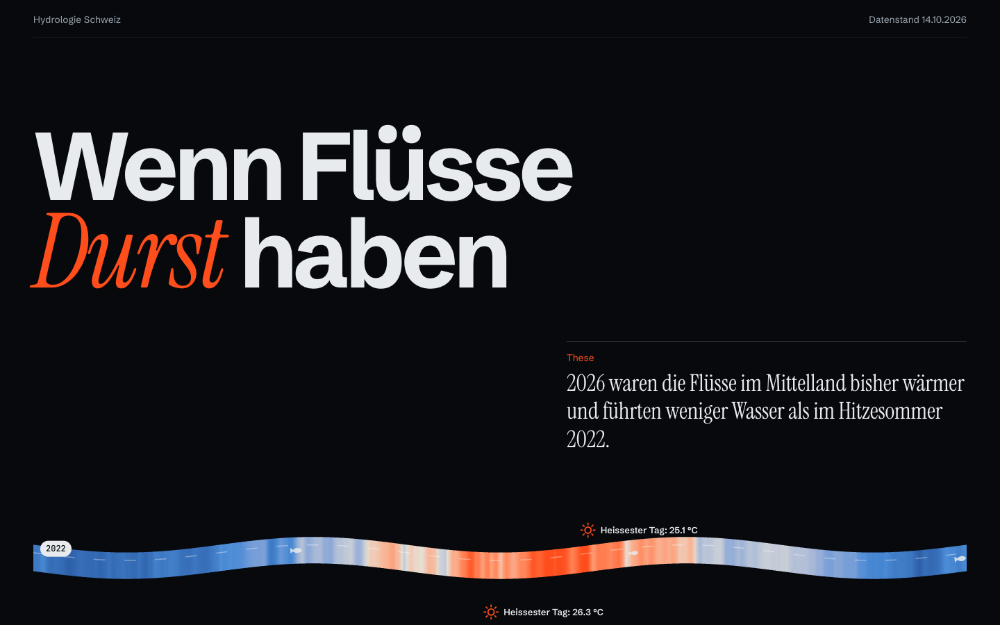
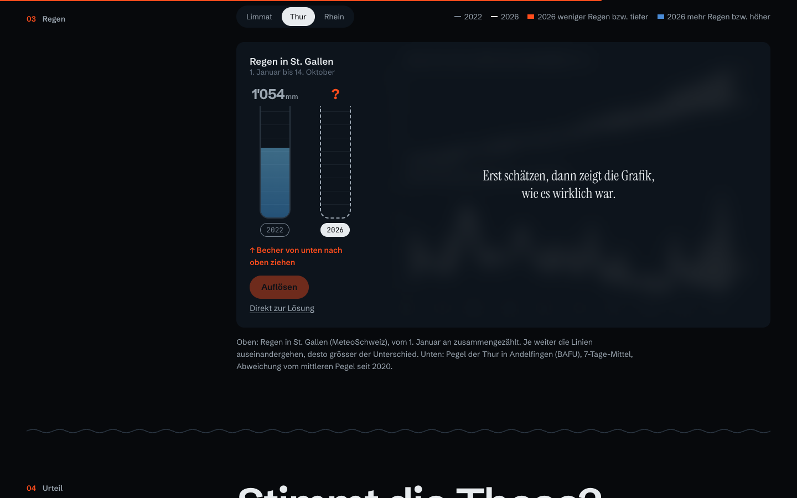
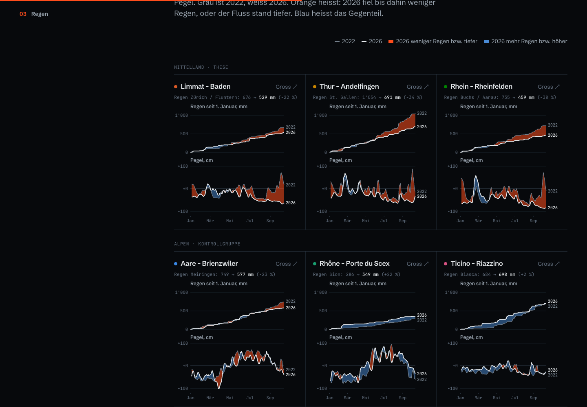
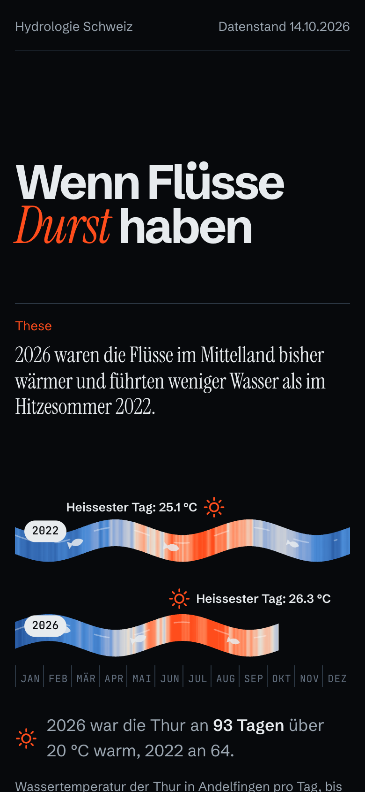
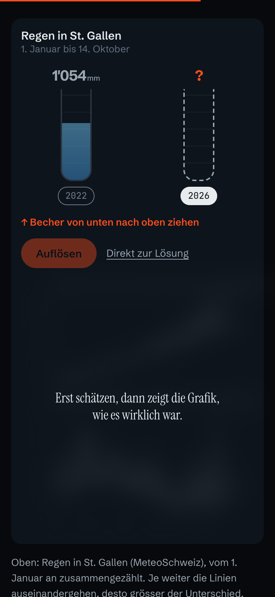
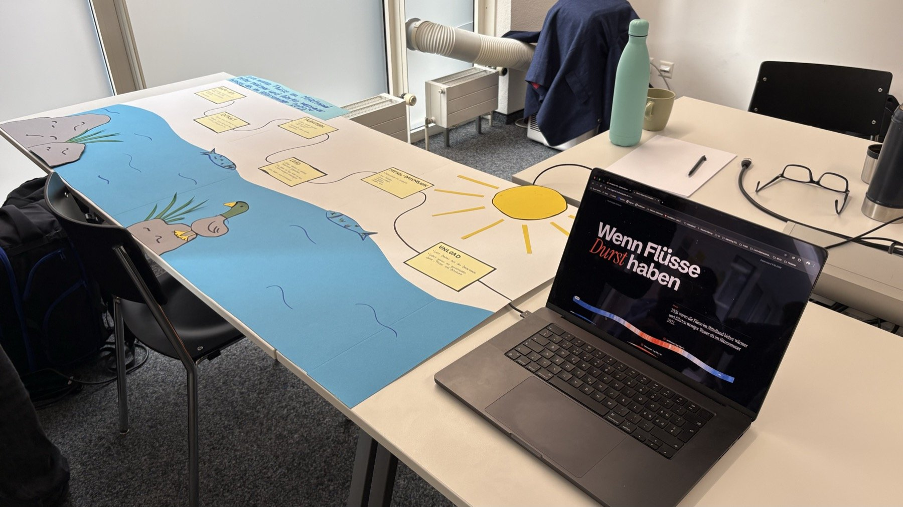

# Wenn Flüsse Durst haben

**Website:** https://im3.ixigamil.myhostpoint.ch/ ·
**Datenquellen / APIs:** [BAFU Hydrologische Beobachtungen](https://api.data-platform.cloud.bafu.admin.ch/dataproduct-water-observations) (GraphQL: https://data.bafu.admin.ch/api) ·
[MeteoSchweiz Open Data, automatische Wetterstationen](https://opendatadocs.meteoswiss.ch/a-data-groundbased/a1-automatic-weather-stations) (CSV über https://data.geo.admin.ch)

## Kurzbeschreibung

Die DataStory prüft die These, dass die Flüsse im Mittelland 2026 bisher wärmer waren und weniger Wasser
führten als im Hitzesommer 2022. Grundlage sind Tagesmittel von Wassertemperatur und Wasserstand an sechs
BAFU-Stationen sowie der Niederschlag von MeteoSchweiz. Ein PHP-ETL-Prozess speichert die Daten täglich in einer
eigenen MySQL-Datenbank. Die Story lässt Lesende Kurven zeichnen und Regenmengen schätzen; eine Datenseite zeigt
alle Details – mit drei Alpenflüssen als Vergleichsgruppe.

## Aufbau

| Teil | Dateien | Aufgabe |
|---|---|---|
| Extract | `etl/extract.php` | Tagesmittel beim BAFU (GraphQL) und Regen bei MeteoSchweiz (CSV) abholen |
| Transform | `etl/transform.php` | jeden Wert beider Quellen prüfen, unplausible verwerfen und zählen, Datum in Schweizer Zeit |
| Load | `etl/load.php`, `etl/schema.sql` | in sechs MySQL-Tabellen speichern, täglich per Cronjob, letzte 60 Tage neu |
| Unload | `unload.php` | JSON nach Datenvertrag liefern, mit geprüften Filtern in der URL |
| Story | `index.html`, `daten.html`, `script.js`, `style.css` | Grafiken mit D3.js, Text und Zahlen aus den Daten berechnet |

## Learnings

- **Eine eigene Datenbank lohnt sich:** Die Website funktioniert auch, wenn die BAFU-API nicht erreichbar ist,
  und eigene Auswertungen (Monatsmittel, Jahresvergleiche) lassen sich direkt in SQL rechnen.
- **Den ETL-Prozess klar trennen:** Extract, Transform und Load in eigenen Dateien machen jeden Schritt
  einzeln testbar und nachvollziehbar.
- **Wiederholbare Importe:** Ein UNIQUE-Key zusammen mit `INSERT … ON DUPLICATE KEY UPDATE` verhindert Duplikate
  und übernimmt trotzdem nachträgliche Korrekturen des BAFU.
- **API zuerst untersuchen:** Mit GraphQL-Introspection (`__schema`) lassen sich die verfügbaren Felder
  zuverlässig ermitteln, statt sie zu erraten.
- **Zeitstempel genau lesen:** «UTC, Beginn des Intervalls» bedeutet beim BAFU, dass ein Wert mit `23:00Z`
  zum *nächsten* Kalendertag gehört.
- **Sicherheit von Anfang an:** Zugangsdaten gehören in eine eigene, per `.gitignore` ausgeschlossene Datei;
  Datenbankabfragen laufen nur über Prepared Statements.
- **Datenjournalistisch sauber arbeiten:** Vergleiche fair machen (gleicher Zeitraum pro Jahr, nur vollständige
  Jahre für Monatsmittel) und offen sagen, was die Daten *nicht* zeigen – etwa, dass weniger Regen eine
  naheliegende, aber nicht die einzige Erklärung für tiefe Pegel ist.
- **Weniger ist mehr:** Eine kurze Story mit drei Grafiken liest sich besser als alles auf einer Seite. Die
  Details gehören auf eine eigene Datenseite für alle, die tiefer graben wollen.
- **Erst raten, dann zeigen:** Wer zuerst selbst schätzt, merkt sich das Ergebnis besser. Dafür darf die Seite
  die Lösung nicht vorher verraten – weder im Titel noch in einer Kennzahl weiter oben.
- **Beide Jahre gleichzeitig zeigen:** Ein Umschalter zwischen 2022 und 2026 macht den Vergleich schwer. Zwei
  Linien übereinander mit eingefärbter Differenz zeigen ihn auf einen Blick.

## Schwierigkeiten

- **10 000-Zeilen-Limit ohne Pagination:** Die BAFU-API lehnt grössere Abfragen ab. Gelöst mit berechneten
  Zeitfenstern und automatischer Halbierung, falls ein Fenster trotzdem zu gross ist.
- **Stilles Abschneiden:** Mit `limit: 10000` in der Abfrage kürzt die API zu grosse Antworten ohne Fehlermeldung.
  Entdeckt erst durch gezieltes Testen; jetzt ohne `limit` und mit Zusatzprüfung gelöst. Ausserdem blockt die API
  Anfragen ohne User-Agent mit HTTP 403 – im Unterrichtsbeispiel für die Sensorbox war das nicht nötig.
- **Zwei sehr verschiedene Quellen:** MeteoSchweiz bietet keine Abfrage-API, sondern pro Station eine CSV-Datei
  (Latin-1-kodiert, über 40 Spalten, Werte ab 1864). Die grosse Datei sprengte zuerst den Arbeitsspeicher; jetzt
  behält das Script nur die drei nötigen Spalten. Ein fehlender Regentag bleibt leer statt 0 mm.
- **Wasserstand in Metern über Meer:** Absolute Pegel (z.B. 570 m ü.M. in Brienzwiler, 198 m ü.M. am Ticino)
  sind nicht vergleichbar. Lösung: Abweichung vom mittleren Pegel jeder Station in Zentimetern.
- **Unklarer Freigabestatus:** Die API liefert neben 1/2/3 oft `null`. Dieser Wert wird als «ohne Status»
  gespeichert und auf der Website ausgewiesen.
- **Verdächtige Messwerte:** Bei Brienzwiler meldet die API im März 2026 drei Tage lang exakt 0.00 °C. Diese
  ungeprüften Werte werden als vermuteter Sensorausfall verworfen und erscheinen als Lücke.
- **Regentag und Flusstag:** MeteoSchweiz zählt einen Regentag von Mitternacht bis Mitternacht Weltzeit, das
  BAFU rechnet in Schweizer Zeit. Die eine Stunde Verschiebung ist für Wochen- und Jahressummen vernachlässigbar
  und auf der Website offen ausgewiesen.
- **Eine Wetterstation pro Fluss:** Eine Station misst den Regen an einem Ort, nicht im ganzen Einzugsgebiet.
  Beim Rhein, dessen Wasser aus der halben Schweiz kommt, ist das nur eine Annäherung.
- **Spoiler im eigenen Text:** Die Regen-Kennzahl weiter oben verriet das Ergebnis des Schätzspiels. Sie wurde
  gestrichen; Titel, Einleitung und Grafik erscheinen pro Fluss erst nach dem Auflösen.
- **Unvollständiges laufendes Jahr:** Für faire Jahresvergleiche wird jedes Jahr nur vom 1. Januar bis zum
  gleichen Stichtag gemittelt.
- **PHP-Eigenheit:** Numerische Array-Keys wie `'2019'` werden automatisch zu Zahlen – die Stationsnummer
  wird deshalb immer aus dem Datensatz gelesen.
- **Tooltips auf dem Handy:** Ein schwebender Tooltip verdeckte die ganze Grafik. Lösung: Auf schmalen
  Bildschirmen erscheinen die Werte in einem Panel unter der Grafik.
- **Deployment:** Zugangsdaten und Import-Token nur auf dem Server hinterlegen, sensible Dateien per
  `.htaccess` sperren und den täglichen Import als Cronjob im Hostpoint Control Panel einrichten.

## Ressourcen

- **Datenquelle:** Bundesamt für Umwelt BAFU, Datensatz «Hydrologische Beobachtungen» –
  https://api.data-platform.cloud.bafu.admin.ch/dataproduct-water-observations
- **Datenquelle Regen:** MeteoSchweiz Open Data, SwissMetNet, Parameter `rka150d0` (Tagessumme Niederschlag) –
  https://opendatadocs.meteoswiss.ch/a-data-groundbased/a1-automatic-weather-stations
- **BAFU-API und Dokumentation** (Filter, Pagination, Ratenbegrenzung, Lizenz):
  https://api.data-platform.cloud.bafu.admin.ch/ · GraphQL-Endpunkt https://data.bafu.admin.ch/api
- **Lizenz der Daten:** «Freie Nutzung. Quellenangabe ist Pflicht.» (opendata.swiss, MeteoSchweiz Open Data)
- **D3.js v7** für die Visualisierungen: https://d3js.org/
- **Schriften** (Google Fonts): Schibsted Grotesk, Instrument Serif, JetBrains Mono – https://fonts.google.com/
- **PHP-Handbuch, PDO:** https://www.php.net/manual/de/book.pdo.php
- **MySQL-Referenz, `INSERT … ON DUPLICATE KEY UPDATE`:**
  https://dev.mysql.com/doc/refman/8.0/en/insert-on-duplicate.html
- **Hostpoint Support, Cronjobs einrichten:**
  https://support.hostpoint.ch/de/produkte/webhosting/haeufig-gestellte-fragen/cronjobs-einrichten
- **Unterrichtsmaterial und Beispielprojekt** des Moduls «Interaktive Medien 3», FHGR
- **KI-Unterstützung:** Claude Code (Anthropic) bei Konzeption, Programmierung und Dokumentation

## Screenshots

### Desktop

### Mobile

  
  

## Foto des Marktstands

